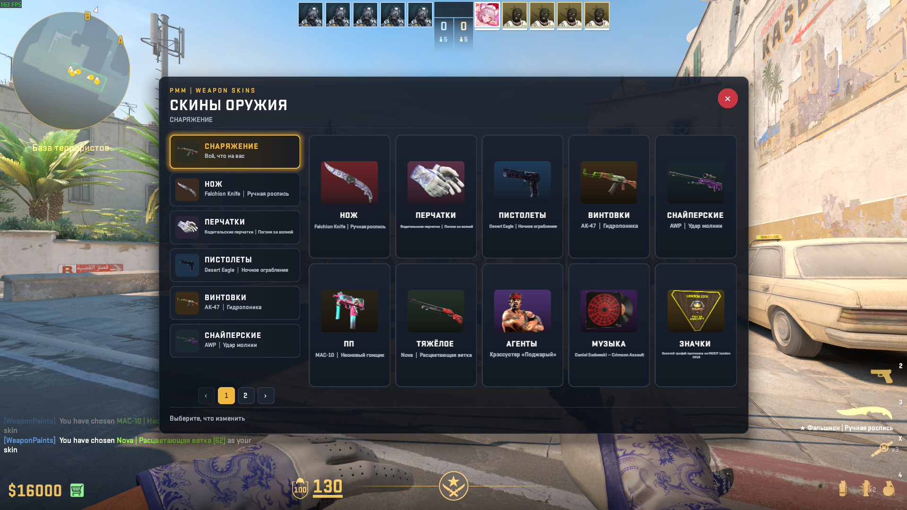

# WeaponPaints and PMM Locker for SwiftlyS2



Two plugins for [SwiftlyS2](https://swiftlys2.net), ported from the CounterStrikeSharp versions:

- **WeaponPaints** keeps skins, knives, gloves, agents, music kits and coins in a database and puts them on the player.
- **PMM WeaponPaints** draws the same items as a card grid on a panorama window and saves what a player clicks.

Neither of them needs CounterStrikeSharp, MenuManager, an extra DLL beside the plugin or a web panel. The database
connection comes from SwiftlyS2 itself, so a fresh server only needs SwiftlyS2, the database and the panorama addon.

## Credits

This is a port, not a new plugin. All design work, the item logic and the panorama look belong to the original authors:

| Original | Author | Link |
| --- | --- | --- |
| PMM WeaponPaints (panorama locker) | **Rimmer** | https://github.com/RRimmer/PMM-WeaponPaints |
| WeaponPaints (skins, gloves, agents) | **Nereziel** | https://github.com/Nereziel/cs2-WeaponPaints |

**SwiftlyS2 port by SyntX34.** License and credits stay with the original authors, the whole port is under the same
[GNU GPL v3](LICENSE) as the originals. The panorama design was inspired by [EliteGames.Ro](https://elitegames.ro).

## What changed in the port

SwiftlyS2 no longer runs CounterStrikeSharp plugins, so the parts that talked to CounterStrikeSharp were rewritten
against the SwiftlyS2 API:

| CounterStrikeSharp | SwiftlyS2 |
| --- | --- |
| `BasePlugin`, `Load`, `OnAllPluginsLoaded` | `BasePlugin`, `Load(bool)`, shared interfaces |
| `IMenu` from MenuManager | menus are built inside PMM, no menu plugin needed |
| menu callbacks from WeaponPaints | the locker writes the same WeaponPaints tables directly |
| reflection into `WeaponPaints.GPlayersAgent` | the WeaponPaints plugin owns the agent row |
| `MySqlConnector` connection from the config | `Core.Database.GetConnection()` from `configs/database.jsonc` |
| `Server.NextFrame` | `Core.Scheduler.NextTick` and `DelayBySeconds` |
| `AddTimer` | `Core.Scheduler.DelayBySeconds` |
| chat menus | custom HUD layout, same `wp.xml` and `wp.css` |

## Repository layout

```
SwiftlyS2/
├── SwiftlyS2.sln                  both plugins in one solution
├── README.md                      this file
├── LICENSE                        GNU GPL v3, from the original projects
├── PMMWPPreview.png               the picture above
├── PMM_WeaponPaints/              the locker plugin
│   ├── PMM_WeaponPaints.csproj
│   ├── panorama/                  wp.xml, wp.css and the knife pictures
│   ├── resources/
│   │   ├── icons.json             item picture to css class
│   │   ├── pmm_items.json         rarities, agents, music kits, coins, gloves
│   │   ├── sql/schema.sql         the tables both plugins use
│   │   ├── translations/          en, ru, da, de, fr, fi, es, hu
│   │   └── wp_triggers.example.json
│   └── src/
│       ├── Plugin.cs              load, wiring, unload
│       ├── Catalog/               weapon tables, item tables, menu building
│       ├── Commands/              the chat commands
│       ├── Config/                config model, settings, trigger file
│       ├── Core/                  constants, per player state, text helpers
│       ├── Data/                  database access and the schema
│       ├── Equip/                 saving a choice
│       ├── Hooks/                 clicks, disconnect, team change
│       ├── Locker/                the window, the back stack, the cards
│       ├── Services/              debug log, player helpers, trigger reader
│       └── View/                  layout, HUD writer, summary, grid
└── WeaponPaints/                  the skin plugin
    ├── WeaponPaints.csproj
    ├── resources/
    │   ├── pmm_items.json
    │   └── sql/schema.sql
    └── src/
        ├── Plugin.cs
        ├── Catalog/               weapon tables, loadout model, item names
        ├── Commands/              the refresh command
        ├── Config/                config model and settings
        ├── Data/                  database access, loadout reader, schema
        ├── Hooks/                 spawn and disconnect
        └── Skin/                  loadout cache and the applier
```

## Requirements

- SwiftlyS2 1.5.0 or newer, with the .NET 10 runtime the framework ships.
- A MySQL, MariaDB, PostgreSQL or SQLite database for the WeaponPaints tables.
- MultiAddonManager with the panorama files built in Workshop Tools, for the locker window.

Nothing else. There is no MenuManager dependency and no `MySqlConnector.dll` to copy.

## Build

```bash
cd SwiftlyS2
dotnet build SwiftlyS2.sln --configuration Release
```

Output lands in `PMM_WeaponPaints/build/net10.0/` and `WeaponPaints/build/net10.0/`. A `dotnet publish` also writes a
zip next to the build folder.

## Install

1. Copy `PMM_WeaponPaints.dll` with its `resources` folder to `addons/swiftlys2/plugins/PMM_WeaponPaints/`.
2. Copy `WeaponPaints.dll` with its `resources` folder to `addons/swiftlys2/plugins/WeaponPaints/`.
3. Copy `panorama` into the addon that MultiAddonManager loads and rebuild it in Workshop Tools.

The plugin folders at runtime look like this:

```
addons/swiftlys2/plugins/
├── PMM_WeaponPaints/
│   ├── PMM_WeaponPaints.dll
│   └── resources/
│       ├── icons.json
│       ├── pmm_items.json
│       ├── sql/schema.sql
│       └── translations/*.jsonc
└── WeaponPaints/
    ├── WeaponPaints.dll
    └── resources/
        ├── pmm_items.json
        └── sql/schema.sql
```

## Database

Both plugins use the connection named in their config, `default` out of the box. Set it up once in
`addons/swiftlys2/configs/database.jsonc`:

```jsonc
{
  "default": {
    "driver": "mysql",
    "host": "127.0.0.1",
    "port": 3306,
    "database": "weaponpaints",
    "user": "weaponpaints",
    "pass": "change me"
  }
}
```

On start each plugin runs `resources/sql/schema.sql`. Every statement is `CREATE TABLE IF NOT EXISTS`, so a database
that already holds WeaponPaints data is left untouched, and a fresh one gets the tables it needs. The tables are:

| Table | Holds |
| --- | --- |
| `wp_player_skins` | finish, wear, seed and name per weapon and per glove |
| `wp_player_knife` | the knife class per side |
| `wp_player_gloves` | the glove family per side |
| `wp_player_music` | the music kit id per side |
| `wp_player_pins` | the coin id per side |
| `wp_player_agents` | the agent model per side |

The database user needs `CREATE`, `SELECT`, `INSERT`, `UPDATE` and `DELETE` on those tables.

## Config

`configs/plugins/PMM_WeaponPaints/config.jsonc`:

```jsonc
{
  "PMM_WeaponPaints": {
    "Commands": ["pws"],
    "Language": "en",
    "OpenDelay": 0.2,
    "InputDelay": 0.2,
    "DatabaseConnection": "default",
    "Debug": false
  }
}
```

`Language` accepts `en`, `ru`, `da`, `de`, `fr`, `fi`, `es` and `hu`. Each language is a
`resources/translations/<code>.jsonc` file with the same keys; English is the fallback.

`configs/plugins/WeaponPaints/config.jsonc`:

```jsonc
{
  "WeaponPaints": {
    "RefreshCommand": "wp",
    "DatabaseConnection": "default",
    "DefaultWear": 0.01,
    "ApplyOnSpawn": true
  }
}
```

## Commands

| Command | Where | What it does |
| --- | --- | --- |
| `!pws` (from `Commands`) | PMM | opens or closes the locker. T and CT only |
| `css_pmm_debug` | PMM | prints the state, `0` or `1` switches the debug log |
| `css_wp` | WeaponPaints | reads the loadout again and puts it on. The locker calls it after every click |
| `css_<RefreshCommand>` | WeaponPaints | a second name for the same refresh |

## Buttons

A button of a custom `wp.xml` does what `wp_triggers.json` next to the DLL says:

| Action | What it does |
| --- | --- |
| `close` | closes the window |
| `back` | one step back |
| `home` | the loadout page |
| `open:knife`, `open:gloves`, `open:skins`, `open:agents`, `open:music`, `open:pins` | opens a section |
| `weapons:pistols`, `rifles`, `snipers`, `smg`, `heavy` | the weapon list of that family |
| `weapons:AK-47,M4A4` | a list of your own |
| `page:prev`, `page:next` | one page back or forward |
| `cmd:css_wp` | runs a `css_` command for the player |

Groups can be replaced under `groups`. Without the file the shipped `wp.xml` works as it is.

## Debug

`"Debug": true` writes `logs/log-PMM_WeaponPaints_debug_<date>.txt` inside the plugin folder, echoes the lines to the
server console and shows them in the chat of the player the line is about.

## Known limits

The port keeps the behaviour of the originals, with two honest differences:

- Glove finishes, music kits and coins are stored and read, but only the glove model is set on the pawn right now. The
  finish needs the attribute list of the econ item, which the SwiftlyS2 schema does not expose safely yet.
- The locker saves the choice and asks WeaponPaints for a refresh. A weapon the player already holds keeps its old
  paint until the next pickup or respawn, because the game does not re-read a fallback skin on a held weapon.

## License

[GNU GPL v3](LICENSE), the license of both original projects. If you change and share this, share it under the same
license and keep the credits above.
